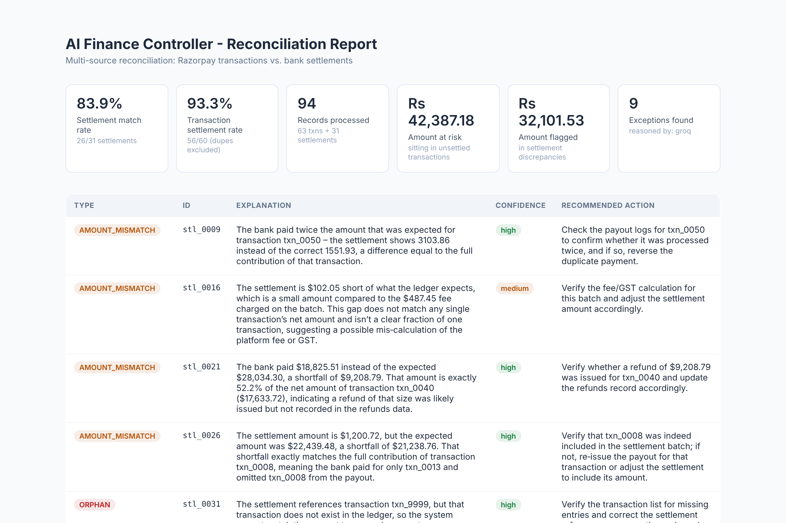

# AI Finance Controller — settlement reconciliation with measured accuracy

[](https://github.com/sarthak1757/Razorpay_AI_Finance_Controller/actions/workflows/tests.yml)


> Built for the **Razorpay AI Buildathon — Track 4 (AI Finance Controller)**.

**The problem.** A merchant has two records of the same money that never line
up 1:1. Razorpay logs one row per payment (gross, fee, GST, net); the bank logs
one credit per payout batch, two days later, with no breakdown. Finance teams
spend hours working out which differences are normal and which are real money
going missing.

**What this does.** Reconciles a Razorpay transaction ledger against a bank
settlement feed. Deterministic arithmetic resolves everything a calculator can
— fees, GST, batching, recorded refunds, T+2 timing. Only the ~8% that survives
goes to an LLM, which explains each exception in plain English and recommends
an action. Every accuracy claim is graded against a hidden ground truth.



## At a glance

| | |
|---|---|
| **Matcher accuracy** | Precision **1.0000**, recall **1.0000** across 160 varied datasets (263,673 records), zero false positives |
| **Throughput** | 156,725 records reconciled in **1.4 s** (~111k records/sec) |
| **AI share** | Only **8.2%** of records ever reach a model, flat at every scale |
| **Root-cause attribution** | Rule baseline **97.01%**; every one of 16,544 "high confidence" calls correct |
| **Honesty layer** | LLM graded against a rule-based control and a "guess the commonest label" control, and the results are reported even where the LLM lost |

```
3 CSVs ──▶ matcher.py (pure arithmetic, no AI) ──▶ ~92% resolved
                     │
                     └──▶ ~8% flagged, with evidence ──▶ reasoner.py (LLM or rule baseline)
                                                              │
                                    report.html ◀── root cause + explanation + action
                                    qa_agent.py ◀── "why was stl_0008 short?"
```

**Try it in 60 seconds, no API key needed:**

```bash
git clone https://github.com/sarthak1757/Razorpay_AI_Finance_Controller.git
cd Razorpay_AI_Finance_Controller
python3 -m venv .venv && source .venv/bin/activate
pip install -r requirements.txt
python3 data/generate_data.py && python3 src/report.py --html   # writes data/report.html
```

**Stack:** Python 3.10 · Groq / Gemini / Anthropic (pluggable) · no frameworks
in the matching path · ~2,800 lines across 8 modules.

The rest of this README is the full evidence: how each number was measured,
and where the system falls short.

---

## Measured results

### Deterministic matcher

Graded against hidden ground truth. Precision and recall are reported
separately, not as a single "match rate", because the two failures cost
different things: a missed exception loses the merchant money, a false flag
wastes an analyst's afternoon.

| | Fixed recipe, 30 seeds | **Varied regimes, 40 seeds** |
|---|---|---|
| Datasets | 120 | **160** |
| Records | 205,479 | **263,673** |
| Precision | 1.0000 | **1.0000** |
| Recall | 1.0000 | **1.0000** |
| True positives | 23,527 | **33,182** |
| False positives | **0** | **0** |
| False negatives | **0** | **0** |
| Datasets with zero errors | 120/120 | **160/160** |

The right-hand column is the one that matters. Changing the seed changes
every amount and date but leaves the *recipe* identical — still ~12% bad
settlements, still the same batch-size mix. `--vary` draws the regime itself
from the seed: exception rates from 4% to 30%, batch sizes from
all-singletons to batches of six, reporting windows from 5 to 21 days. A
high-volume merchant with clean books and a small one with messy books are
different problems. Both hold.

Every dataset also contains legitimate, properly-recorded refunds that exist
purely as **false-positive bait**. A matcher that ignored `refunds.csv` would
flag them and its precision would drop below 1.0.

### Throughput — two phases, reported separately

Phase 1 scales with record count; phase 2 scales with *exception* count. One
blended number would hide the entire architecture.

| Transactions | Records | Matching | Records/sec | Exceptions | Reaching the AI |
|---|---|---|---|---|---|
| 1,000 | 1,563 | 0.011s | 137,960 | 128 | 8.2% |
| 5,000 | 7,871 | 0.058s | 136,578 | 647 | 8.2% |
| 25,000 | 39,217 | 0.311s | 125,975 | 3,223 | 8.2% |
| 100,000 | 156,725 | **1.408s** | 111,291 | 12,874 | 8.2% |

156,725 records reconciled in 1.4 seconds. The AI share stays flat at 8.2%
at every scale — over 91% of records never touch a model.

### Root-cause attribution

The reasoner must name the true cause of each exception from a fixed
taxonomy of seven. Graded against the injected truth.

**Rule baseline (the control): 97.01%** — 24,538 of 25,294 cases across the
160 varied-regime datasets, orphans excluded.

Its calibration is the interesting part:

| Stated confidence | Correct | Accuracy |
|---|---|---|
| high | 16,544 / 16,544 | **1.0000** |
| medium | 7,994 / 8,750 | 0.9136 |

Every single "high confidence" call, across 16,544 of them, was right. That
means confidence is a usable routing signal rather than decoration — you can
auto-clear the high-confidence findings and put a human on the rest.

**LLM on the adversarial sample:** see below.

### Admitting it doesn't know

A closed taxonomy has a nasty failure mode: forced to pick one of four causes,
a classifier always picks one. A genuinely novel problem gets filed under
whichever label it least resembles, and you get a confident, specific, **wrong**
diagnosis. Grading only against causes you injected can never reveal this,
because you never showed it a surprise.

So there is a seventh label, `unknown_anomaly`, and `--novel-rate` injects
mechanisms deliberately **outside** the taxonomy — a chargeback plus a penalty
fee, a bank rounding a payout down to a round ₹10,000, a correctly-recorded
refund deducted twice. The right answer for all of them is "I don't recognise
this", not the nearest label.

This cannot be graded with one number — the label is gameable both ways — so
three are reported, with both degenerate controls:

| Rule baseline · 160 varied datasets · 8% novel | |
|---|---|
| Novel-detection **recall** | 3,733 / 6,511 = **0.573** |
| Novel-detection **precision** | 3,733 / 4,142 = **0.901** |
| Accuracy on **known** causes *(regression guard)* | 24,538 / 25,294 = **0.9701** |
| *Control — never say unknown* | recall 0.000 |
| *Control — always say unknown* | recall 1.000, precision 0.205, known accuracy **0.000** |

It beats both degenerate strategies at once, which is the only way this label
is worth having.

**The regression guard is the number to watch**: known-cause accuracy is
0.9701 whether or not novel cases are present — byte-identical across both
runs. Adding the escape hatch did not damage ordinary attribution; it isn't
being used to dodge hard cases.

The matcher is **unaffected**: precision and recall stay at 1.0000 with novel
causes present. It still *finds* every one of them; naming them is the
reasoning layer's job, and that's where the shortfall is — 2,650 novel cases
were filed as `unrecorded_refund`, mostly chargebacks whose gap happens to
land inside the refund-shaped window.

That gap looked like the clearest remaining case for using a model at all: a
fixed threshold cannot separate "42% of one payment's net" from "one payment's
net plus ₹800", but reasoning over the batch composition can. So it was
measured — on a **class-balanced** sample (50 novel / 50 known, drawn from a
population whose true novel base rate is 32.2%, so precision is re-weighted to
the real rate rather than the sampled one):

| 100 balanced cases · `data/validation_novel_eval_groq.json` | Rule baseline | LLM (`gpt-oss-20b`) |
|---|---|---|
| Novel-detection recall | 22 / 50 = **0.44** | 21 / 50 = **0.42** |
| Precision at true base rate | **0.913** | **0.909** |
| False-alarm rate | 0.02 | 0.02 |
| Accuracy on **known** causes *(regression guard)* | 49 / 50 = **0.98** | 34 / 50 = **0.68** |

*(The 0.44 here and the 0.573 above are different experiments, not a
discrepancy: the sweep scores every novel case across 160 datasets, while this
is a 100-case balanced sample built for a like-for-like LLM comparison at
affordable API cost.)*

**The LLM ties on detection and loses badly on the rest.** Novel recall is the
same within noise — but it misclassifies ordinary cases at fifteen times the
baseline's rate. Not by over-using the escape hatch, which both used exactly
once: it confuses `overpayment_duplicate_payout` with `missing_txn_in_batch`
ten times out of fifty. It is misreading the **sign** of the discrepancy —
whether the bank paid too much or too little — even though `direction` is
handed to it as an explicit signal.

Per mechanism, both are blind in the same place:

| Injected mechanism | Rule baseline | LLM |
|---|---|---|
| `chargeback_with_penalty` | 21 / 30 = 0.70 | 20 / 30 = 0.67 |
| `partial_round_payout` | 1 / 19 = **0.05** | 1 / 19 = **0.05** |
| `double_deducted_refund` | 0 / 1 | 0 / 1 |

Neither notices a payout rounded down to a flat ₹10,000 — a pattern plainly
visible in the data that neither the rules nor the prompt were built to look
for. That is the honest edge of this system, and knowing exactly where it sits
is worth more than a number to quote.

```bash
python3 src/grade.py --vary --novel-rate 0.08 --seeds $(seq 1 40) \
    --sizes 60 300 1000 3000 --out data/validation_novel.json
```

### The comparison that actually discriminates

Grading an LLM on a random sample mostly measures how often it agrees with
you about easy cases. Our first honest run scored 40/40
(`data/validation_ai.json`) — and so did the rule baseline. Two perfect scores on an easy exam say nothing about which grader
is better.

So `--hard-cases` sweeps many datasets with the **free** rule baseline, keeps
only the cases it gets *wrong*, and grades the LLM on those. The baseline
scores 0% on that sample by construction. The question becomes: *when a
hand-tuned threshold breaks, does reasoning recover it?*

**The answer, so far, is no — and that is reported here rather than buried.**

| On 34 cases the rule baseline got wrong | |
|---|---|
| Rule baseline, by construction | 0 / 34 = **0.000** |
| LLM (`gpt-oss-20b`), of cases it answered | 11 / 22 = **0.500** |
| **Control — always guess the commonest label** | 19 / 22 = **0.864** |
| Excluded: no usable answer returned | 12 (10 × HTTP 429, 2 truncated) |

The LLM did **not** beat a strategy that ignores the evidence entirely and
always says `unrecorded_refund`.

That constant guess is not a real rival system — the sample is *selected* by
"the baseline was wrong", the baseline errs asymmetrically, and that skews the
label mix 19:3. A constant guess exploits the selection and would be useless
on the true distribution. But the model failing to beat it means **this run
does not demonstrate that the LLM recovers the baseline's failures**, and
`grade.py` now computes that control automatically so the comparison can
never be quietly skipped.

Two caveats, both pointing the same way:

- **The run was cut short.** The free tier's 200,000 tokens-per-day ceiling
  was exhausted partway through, so 12 of 34 cases returned no usable answer.
  Those are excluded from the denominator — a call that never returned is our
  infrastructure failing, not the model being wrong — which leaves a thin
  22-case sample. **That run has since been superseded** rather than left
  outstanding: the class-balanced novel-cause evaluation
  (`data/validation_novel_eval_groq.json`) completed cleanly — 100 cases
  attempted, 100 answered, zero infrastructure failures — and reached the
  same conclusion this truncated run pointed at.
- **22 cases is small.** The honest reading is "not demonstrated", not
  "disproven".

### What four measurements say, taken together

The LLM was given four chances to demonstrate it beats deterministic rules at
classification, and the answer was consistent:

| Evaluation | LLM | Control | Outcome |
|---|---|---|---|
| Random sample (`validation_ai.json`) | 40 / 40 | rule baseline 40 / 40 | tied — exam too easy to discriminate |
| Adversarial sample (`validation_hard.json`) | 0.500 | majority-class guess 0.864 | did not clear the control; quota-truncated |
| Novel detection, balanced (`validation_novel_eval_groq.json`) | 0.42 recall | rule baseline 0.44 | tied |
| Known-cause accuracy on that same sample | **0.68** | rule baseline **0.98** | **materially worse** |

**The deterministic layer is where the value is.** The matcher is exact, the
rule baseline attributes 97.01% correctly with perfectly calibrated
confidence, and across four independent framings the LLM was never shown to
beat it — on the last one it was measurably worse.

That is reported here rather than buried, because the alternative was
quoting "50% recovery on adversarial cases" as a win when it is a number
worse than guessing. What the model *does* contribute is the part no rule
produces: the plain-English explanation, the recommended action, and the
open-ended Q&A in `src/qa_agent.py`. The classification is arithmetic's job,
and the measurement is what proves it.

---

## Quickstart

```bash
python3 -m venv .venv && source .venv/bin/activate
pip install -r requirements.txt

python3 data/generate_data.py          # canonical dataset
python3 src/report.py --html           # reconcile + readable report
```

Without an API key everything still runs — the reasoner falls back to the
rule baseline, so the pipeline is testable end to end for free. For real LLM
attribution, put a key in `.env`:

```
GROQ_API_KEY=...          # or ANTHROPIC_API_KEY / GEMINI_API_KEY
```

> Install `requirements.txt` in the venv. Without `python-dotenv` the `.env`
> file is never read, the key never loads, and the system silently falls back
> to the rule baseline.

## Run it on your own data

Point it at any directory containing the three CSVs:

```bash
python3 src/report.py --data-dir /path/to/my/data --html
python3 src/qa_agent.py --data-dir /path/to/my/data "why was stl_0008 short?"
```

**Required columns** (extra columns are carried through and ignored):

| File | Columns |
|---|---|
| `razorpay_transactions.csv` | `transaction_id`, `order_id`, `amount`, `razorpay_fee`, `gst_on_fee`, `net_amount`, `timestamp` |
| `bank_settlements.csv` | `settlement_id`, `settled_amount`, `settlement_date`, `transaction_ids_included` |
| `refunds.csv` *(optional)* | `transaction_id`, `refund_amount` |

The ingest layer accepts the dialects real exports actually use — `1,234.56`,
`Rs 1,234.56`, `(45.00)` for accounting negatives, ISO-T timestamps with
timezones, `DD/MM/YYYY`, and ID lists separated by `;` `,` `|` or spaces. A
dataset it genuinely cannot read fails loudly, naming the file, column and
row — it never half-reconciles and reports a confident wrong total.

```bash
python3 tests/test_ingest.py      # 12 tests proving the above
```

## Reproduce every number

```bash
# Structural accuracy across 160 varied-regime datasets (no API key needed)
python3 src/grade.py --vary --seeds $(seq 1 40) --sizes 60 300 1000 3000 \
    --out data/validation_varied.json

# Adversarial LLM evaluation — grades the model ONLY on cases the rule
# baseline gets wrong. Needs an API key.
python3 src/grade.py --hard-cases --seeds $(seq 1 40) --sizes 300 \
    --sleep 5 --out data/validation_hard.json

# Novel-cause detection: LLM vs rule baseline on ONE balanced sample.
# --reasoner forces a backend, so two models can be compared on identical cases.
python3 src/grade.py --novel-eval --reasoner groq --seeds $(seq 1 20) \
    --sizes 300 --novel-rate 0.08 --sample-per-class 50 --sleep 7 \
    --out data/validation_novel_eval_groq.json
```

Supported backends: `groq`, `gemini`, `anthropic`, `baseline`. Without
`--reasoner`, whichever key appears first in `.env` wins — which silently makes
a two-model comparison impossible, so always name it when comparing.

`--sleep` paces calls under a free tier's tokens-per-minute ceiling. Without
it the SDK sits in backoff and the run takes far longer.

Run everything from the repo root, not from `src/`.

## Layout

```
data/generate_data.py   synthetic data + hidden ground truth (--seed/--n/--vary)
src/causes.py           the cause taxonomy — single source of truth
src/matcher.py          deterministic matching + evidence signals. No AI.
src/reasoner.py         pluggable LLM backends + the rule baseline control
src/exception_agent.py  feeds flagged exceptions to the reasoner
src/report.py           two-phase throughput, accuracy, honest exception list
src/render_report.py    report.json -> report.html
src/qa_agent.py         plain-English Q&A (two-tier context, no RAG by design)
src/grade.py            the honesty layer: structural + attribution grading
tests/test_ingest.py    proves the ingest layer accepts datasets that aren't ours
```

See [ARCHITECTURE.md](ARCHITECTURE.md) for the design and the reasoning
behind it — in particular §3, the evidence boundary, which is what makes the
attribution accuracy figure a real measurement rather than a formality.

## Honest limitations

- **The data is synthetic.** It has to be — attribution accuracy is only
  measurable against causes you injected. The ingest tests address *format*
  generality; they cannot prove real discrepancies have the same statistical
  shape as our injected ones.
- **The taxonomy is closed**, but it now has an escape hatch. A cause nobody
  enumerated should come back as `unknown_anomaly` rather than the nearest
  label — measured at 0.573 recall / 0.901 precision for the rule baseline.
  That still means **43% of novel problems get a confident wrong label**. The
  LLM was measured on a balanced sample and did no better (0.42 vs 0.44 recall).
- **The rule baseline knows the answers exist.** Its thresholds were written
  by someone who knew which four causes were injected. On genuinely unseen
  data it could degrade in a way the LLM plausibly would not. The adversarial
  and novel-cause evaluations probed this; so far the LLM has not been shown
  to recover what the rules miss.
- **T+2 is hardcoded** as the settlement SLA, and duplicate detection assumes
  `order_id` is meaningful.
